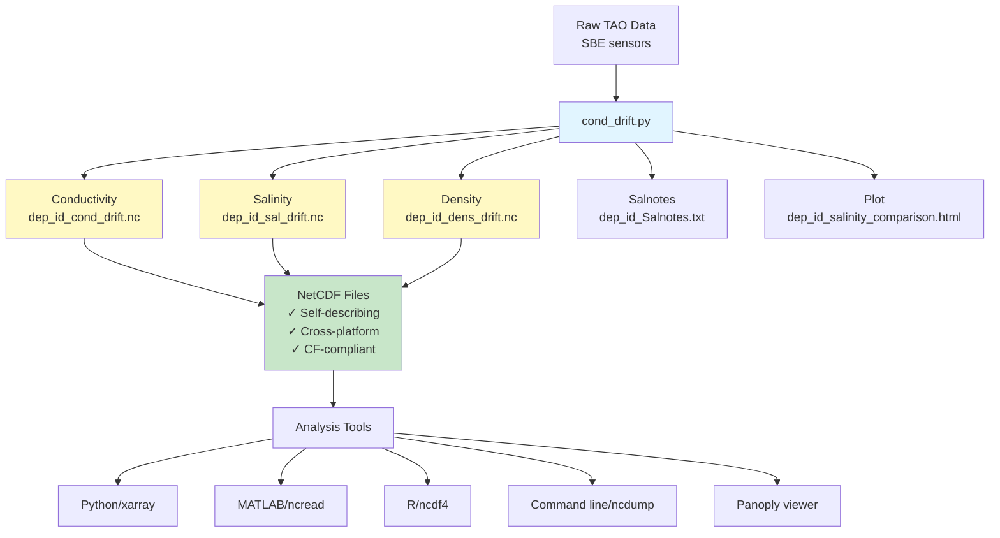

# Data Processing Workflow

## Updated Workflow with NetCDF



## Processing Steps

### 1. Load Deployment Data
- Read SBE sensor data from flexram files
- Load pre- and post-calibration coefficients
- Extract conductivity, temperature data

### 2. Apply Drift Correction
- Calculate pre-cal and post-cal conductivity
- Compute differences
- Apply time-dependent drift correction
- Account for valid data periods only

### 3. Calculate Derived Variables
- **Salinity** from conductivity using GSW toolbox
- **Density** (sigma0) from salinity using GSW toolbox

### 4. Save Results in NetCDF Format
Each file contains:
- Time series data for all sensors/depths
- Complete metadata (units, serial numbers, depths)
- Global attributes (deployment ID, location, processing)
- CF-1.8 convention compliance

### 5. Generate Quality Control Products
- **Salnotes**: Text summary of calibration and drift
- **HTML Plot**: Interactive comparison of original vs corrected salinity

## File Formats

### Input Files
```
{base_path}/{dep_id}-sbe-data.bz2  # Raw sensor data
{base_path}/config.xml              # Metadata and calibration
```

### Output Files (New Format)
```
{dep_id}_cond_drift.nc              # Conductivity (mS/cm) with metadata
{dep_id}_sal_drift.nc               # Salinity (PSU) with metadata
{dep_id}_dens_drift.nc              # Density (kg/m³) with metadata
{dep_id}_Salnotes.txt               # Text summary
{dep_id}_salinity_comparison.html   # Interactive plot
```

### Output Files (Old Format - Deprecated)
```
{dep_id}cond_drift.pkl              # ❌ Replaced by .nc
{dep_id}sal_drift.pkl               # ❌ Replaced by .nc
{dep_id}dens_drift.pkl              # ❌ Replaced by .nc
```

## Data Structure in NetCDF Files

### Variable Naming Convention
```
{variable}_{serial_number}_{depth_label}
```

Examples:
- `salinity_12345_SSS` - Sea surface salinity from instrument 12345
- `salinity_12345_S010` - Salinity at 10m from instrument 12345
- `conductivity_67890_S120` - Conductivity at 120m from instrument 67890

### Attributes

**Global (file-level):**
- deployment_id
- latitude, longitude
- institution, source
- conventions (CF-1.8)
- processing description
- creation_date

**Variable (per sensor):**
- units
- long_name
- serial_number
- depth_label
- standard_name (where applicable)

## Migration Path

### For New Deployments
```bash
# Just run the updated script
python cond_drift.py pt006
# Creates .nc files automatically
```

### For Existing Pickle Files
```bash
# Convert old files to netCDF
python convert_pkl_to_nc.py pt006sal_drift.pkl \
    --type salinity \
    --dep-id pt006 \
    --lat 0.0 --lon -140.0
```

### For Existing Analysis Scripts
```python
# Old code:
df = pd.read_pickle('pt006sal_drift.pkl')

# New code (minimal change):
import xarray as xr
ds = xr.open_dataset('pt006_sal_drift.nc')
df = ds.to_dataframe()
ds.close()
```

## Quality Control Features

### Valid Data Period Tracking
- Script identifies first and last valid data points for each sensor
- Excludes NaN values from drift correction
- Reports valid data percentage in console output

### Drift Correction Method
- Time-dependent linear interpolation
- Based on pre- and post-deployment calibration
- Applied only to valid data points
- Preserves NaN values in output

### Verification
- Statistical summaries in Salnotes file
- Visual comparison plots (original vs corrected)
- Mean differences and standard deviations calculated

## Using the Output Files

### Quick Inspection (Command Line)
```bash
# View file structure
ncdump -h pt006_sal_drift.nc

# View all data
ncdump pt006_sal_drift.nc

# View specific variable
ncdump -v salinity_12345_SSS pt006_sal_drift.nc
```

### Python Analysis
```python
import xarray as xr
import matplotlib.pyplot as plt

# Open dataset
ds = xr.open_dataset('pt006_sal_drift.nc')

# Plot a time series
var_name = 'salinity_12345_SSS'
ds[var_name].plot()
plt.title(f"{ds[var_name].attrs['long_name']}")
plt.ylabel(f"{ds[var_name].attrs['units']}")
plt.show()

ds.close()
```

### MATLAB Analysis
```matlab
% Read netCDF file
sal = ncread('pt006_sal_drift.nc', 'salinity_12345_SSS');
time = ncread('pt006_sal_drift.nc', 'time');

% Get metadata
units = ncreadatt('pt006_sal_drift.nc', 'salinity_12345_SSS', 'units');
sn = ncreadatt('pt006_sal_drift.nc', 'salinity_12345_SSS', 'serial_number');

% Plot
plot(time, sal)
ylabel(['Salinity (' units ')'])
title(['Serial Number: ' sn])
```

## Benefits Summary

| Feature | Pickle (.pkl) | NetCDF (.nc) |
|---------|---------------|--------------|
| **Python version compatibility** | ❌ Version-specific | ✅ Universal |
| **Self-describing** | ❌ No metadata | ✅ Full metadata |
| **Cross-platform** | ⚠️ Python only | ✅ Many languages |
| **Human-readable** | ❌ Binary blob | ✅ Via ncdump |
| **Standards compliance** | ❌ No standards | ✅ CF-1.8 |
| **Long-term archival** | ❌ Risky | ✅ Recommended |
| **Compression** | ⚠️ Limited | ✅ Built-in |
| **Partial reads** | ❌ All or nothing | ✅ Subset access |
| **Security** | ⚠️ Code execution risk | ✅ Safe |

## Troubleshooting

### Common Issues

**"ImportError: No module named 'xarray'"**
```bash
conda install xarray netcdf4
```

**"No such file or directory: '{dep_id}_sal_drift.nc'"**
- File name changed from `{dep_id}sal_drift.pkl` to `{dep_id}_sal_drift.nc`
- Note the underscore before "sal"

**Bokeh timezone warning**
- Fixed in updated script
- Datetime index now converted to UTC-aware timestamps

### Getting Help

1. Check **NETCDF_README.md** for detailed usage examples
2. Check **MIGRATION_GUIDE.md** for step-by-step migration
3. Run `python read_netcdf_example.py --help`
4. Use `ncdump -h file.nc` to inspect file structure

---

**Last Updated:** 2026-10-19  
**Script Version:** cond_drift.py with netCDF support
